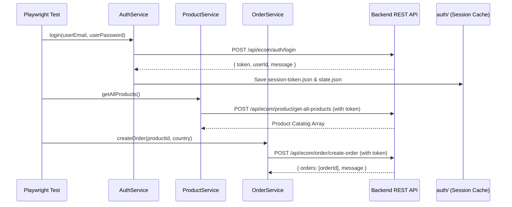

# API Test Automation Layer

The `api/` directory encapsulates all REST API services, payload models, and session management logic for the Rahul Shetty Academy Client application.

---

## Architecture & Workflow



---

## Services Overview

### 1. `AuthService.ts`
Handles API-level authentication and produces credentials/tokens for both API and UI test suites.

- **Key Methods**:
  - `login(userEmail, userPassword)`: Performs `POST /api/ecom/auth/login` and returns `LoginResponse`.
  - `saveSessionState(loginData, authDir)`:
    - Writes raw token and user details to `auth/session-token.json`.
    - Generates Playwright-compatible `storageState` format to `auth/state.json` (populating `localStorage` with `token` and `userId` under the application origin).
  - `static loadSessionToken(authDir)`: Reads and deserializes cached session tokens from disk.

### 2. `ProductService.ts`
Interacts with the product catalog endpoints.

- **Key Methods**:
  - `getAllProducts(): Promise<Product[]>`: Fetches all catalog products via `POST /api/ecom/product/get-all-products`.
  - `getProductByName(productName: string): Promise<Product | undefined>`: Searches and returns a product matching the specified name.

### 3. `OrderService.ts`
Handles order placement and order history inspection.

- **Key Methods**:
  - `createOrder(productId: string, country: string): Promise<CreateOrderResponse>`: Posts order payload to `POST /api/ecom/order/create-order`.
  - `getOrderDetails(orderId: string): Promise<any>`: Retrieves details for a specific order ID via `GET /api/ecom/order/get-orders-details`.

---

## Types & Data Models

### `LoginResponse`
```typescript
export interface LoginResponse {
    token: string;
    userId: string;
    message: string;
}
```

### `Product`
```typescript
export interface Product {
    _id: string;
    productName: string;
    productCategory: string;
    productSubCategory: string;
    productPrice: number;
    productDescription: string;
    productImage: string;
    productRating: string;
    productTotalOrders: string;
    productStatus: boolean;
    productFor: string;
    productAddedBy: string;
}
```

### `CreateOrderResponse`
```typescript
export interface CreateOrderResponse {
    orders: string[];
    productOrderId: string[];
    message: string;
}
```

---

## Hybrid Session Integration (API -> UI)

One of the framework's core performance advantages is using `AuthService.saveSessionState` to bootstrap browser sessions:

1. API authentication completes in ~200ms.
2. Playwright `storageState` (`auth/state.json`) is populated with token and user ID into `localStorage`.
3. UI tests in `tests/hybrid-session.spec.ts` use `test.use({ storageState: 'auth/state.json' })`.
4. Browser navigates directly to `/dashboard/dash`, skipping the login form and reducing execution time significantly.
